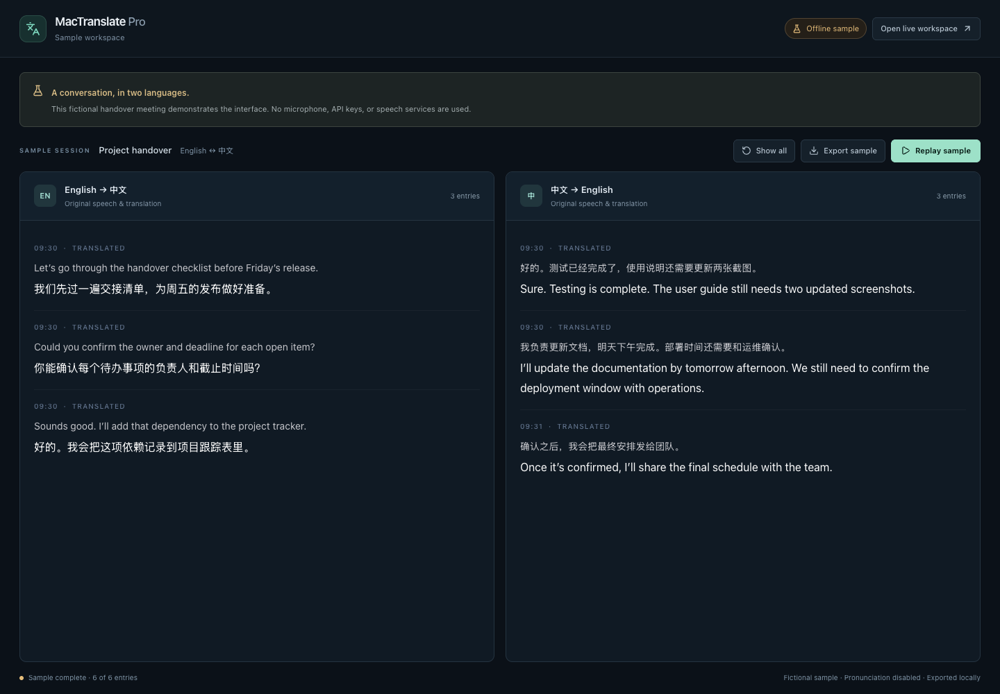

# MacTranslate Pro

An English–Chinese interpretation workspace with live transcription, translation, and word pronunciation.

I built MacTranslate Pro to keep both sides of a bilingual conversation readable in one place. Each panel preserves the recognized speech alongside its translation. Corrections remain visible, and the conversation stays available while I review earlier entries.



*The screenshot uses fixed fictional sample data. It is an interface preview, not a speech-recognition benchmark.*

## Try the workspace

The sample runs without credentials or microphone access:

```bash
npm ci
npm run demo
```

Open [localhost:4173/demo](http://localhost:4173/demo). Replay the sample conversation, pause it, or export the visible entries as a text file. This route uses the same transcript panels as the live workspace, with pronunciation disabled. It does not connect to speech or translation services.

## What it does

- Displays English → Chinese and Chinese → English in separate, labeled panels.
- Streams interim recognition and translation results before a final result arrives.
- Shows changes between recognized and corrected speech.
- Supports Azure Speech, Qwen3-ASR through DashScope, and Soniox Realtime.
- Uses OpenAI for correction and translation, with a model selector in Settings.
- Provides English word pronunciation, with dictionary lookup and TTS fallbacks.
- Lets me select microphone and pronunciation output devices, track session time, and export the current transcript.

I keep Azure as the default. The Qwen and Soniox integrations remain experimental. Their endpointing behavior differs, so the server keeps separate merge and commit settings for each provider.

## Run a live session

Requirements: Node.js 20.19+ or 22.12+, npm, a microphone-capable browser, and provider credentials. I use a local Express server on `127.0.0.1:3000`; the browser needs microphone permission.

```bash
npm ci
cp .env.example .env
```

Set these values in `.env`:

| Variable | Use |
| --- | --- |
| `AZURE_SPEECH_KEY` | Azure Speech recognition |
| `AZURE_SPEECH_REGION` | Azure resource region |
| `OPENAI_API_KEY` | Transcript correction, translation, and optional pronunciation fallback |

Then start the app:

```bash
npm run dev
```

Open [localhost:3000](http://localhost:3000), choose the microphone, and select **Start session**. **Settings** contains the ASR provider, translation model, and connection checks. Changing the ASR provider stops an active session; the next start uses the new provider.

The current startup health check requires the Azure variables even when an experimental provider is selected. In that case, the corresponding provider key is also needed.

### Optional configuration

| Variable | Use |
| --- | --- |
| `DASHSCOPE_API_KEY` | Qwen3-ASR |
| `DASHSCOPE_REGION` | Set to `cn` for the mainland endpoint; otherwise the international endpoint is used |
| `SONIOX_API_KEY` | Soniox Realtime |
| `SONIOX_WS_URL` | Custom Soniox WebSocket endpoint |
| `MW_MEDICAL_API_KEY`, `MW_COLLEGIATE_API_KEY` | Dictionary pronunciation lookup |
| `AZURE_TTS_VOICE` | Azure pronunciation fallback voice |
| `OPENAI_TTS_MODEL`, `OPENAI_TTS_VOICE` | OpenAI pronunciation fallback |

Provider access and model availability depend on the configured accounts. The example environment file contains placeholders only.

### Production build

```bash
npm run build
npm start
```

On macOS, `./Start.command` builds the client and starts the local production server. `npm run preview` previews only the built frontend; live interpretation requires the Express server.

## How I structured it

```text
Microphone → AudioWorklet → local WebSocket server
                                  ↓
                         selected ASR provider
                                  ↓
                      correction + translation
                                  ↓
                    original / translated panels
```

The browser captures PCM audio and sends it to Express. The server manages ASR, conversation context, translation, pronunciation, and local session recording. I keep provider-specific timing in the server and keep UI display throttling in the client.

| Location | Responsibility |
| --- | --- |
| `server.ts` | WebSocket sessions, translation, pronunciation, logs |
| `asr-engines.ts` | ASR provider adapters |
| `src/hooks/` | Microphone capture, audio streaming, connection recovery |
| `src/components/TranslationPanel.tsx` | Transcript display, correction differences, pronunciation |
| `src/demo/` | Isolated sample workspace and fictional conversation |
| `src/services/transcriptExport.ts` | Chronological text export from the current panels |

More detail: [architecture and tradeoffs](docs/architecture.md).

## Data and practical limits

The application runs locally, but live recognition and translation use cloud services. Audio goes to the selected ASR provider; text goes to OpenAI. Pronunciation can make dictionary or TTS requests. API keys stay in the server environment.

The server writes diagnostic logs and session transcripts under `logs/`. It attempts to remove session transcript files older than 30 days at startup. These files, pronunciation caches, and `.env` are excluded from Git. Browser storage holds settings and daily usage counters.

The interface retains the latest 200 entries per language panel. **Export** downloads those current entries in chronological order and labels translations that are still in progress. It is not an export of the complete server-side session archive.

This is a local, single-user tool. There is no account system or public deployment hardening. Speech recognition and translation can make mistakes, particularly with names, numbers, accents, and specialized terminology. I treat the output as something to review, and I do not claim a measured accuracy or latency benchmark.

## Checks

```bash
npm run lint
npm test
npm run build
```

`lint` runs TypeScript checking. The automated tests cover transcript ordering, corrections, partial results, bilingual entries, and sample labeling. They do not validate cloud recognition or translation quality. My [manual check list](docs/testing.md) covers the sample UI and live-session checks separately.
